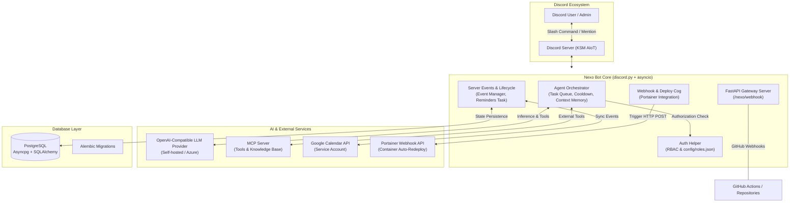

# Nexo 🤖

**Nexo** adalah asisten Discord cerdas bertenaga LLM (*Large Language Model*) dan *Model Context Protocol* (MCP) yang dikembangkan khusus untuk **KSM AIoT** (Kelompok Studi Mahasiswa Artificial Intelligence & Internet of Things, UPN "Veteran" Jakarta). Provider LLM dapat berupa layanan self-hosted maupun endpoint OpenAI-compatible seperti Azure.

Nexo bertindak sebagai *Smart Community Assistant* yang mampu berinteraksi secara kontekstual, mengelola acara komunitas, menyinkronkan jadwal dengan Google Calendar, memproses Webhook GitHub CI/CD, hingga memicu *redeploy* kontainer otomatis via Portainer Webhook API dengan otorisasi keamanan berbasis peran (RBAC).

---

## 🏛️ Arsitektur Sistem

Berikut adalah gambaran arsitektur sistem Nexo:



---

## ✨ Fitur Utama

- **Percakapan AI & konteks per pengguna+channel:** Nexo dapat ditanya melalui mention `@Nexo` atau `/tanya`. Tiap pengguna memiliki riwayat terpisah pada setiap channel agar topik tidak tercampur.
- **Asynchronous Task Queue & Rate Limiting:** Menggunakan antrean *non-blocking* dengan sliding cooldown 5 detik per pengguna guna mencegah *queue starvation* atau serangan Denial of Service (DoS).
- **Local AI Tools & Strict Pydantic Schemas:** LLM dapat memanggil fungsi-fungsi lokal Discord menggunakan skema validasi Pydantic yang ketat:
  - 📅 **Manajemen Acara:** Membuat dan mengakhiri Discord Scheduled Events lengkap dengan siaran pengumuman dinamis.
  - 📆 **Sinkronisasi Google Calendar:** Integrasi dua arah dengan Google Calendar menggunakan Google Service Account.
  - ⏰ **Smart Event Reminders:** Background task yang otomatis mengirimkan pengingat H-7, H-3, H-1, H-3 jam, H-1 jam, dan saat acara dimulai dengan format bahasa Indonesia (WIB).
  - 🧵 **Thread Creation & Polls:** Membuat forum diskusi thread dan jajak pendapat interaktif.
  - 🧹 **Message Purge:** Membersihkan pesan di channel secara aman dan asinkron.
- **Role-Based Access Control (RBAC):** Seluruh aksi destruktif atau administratif diverifikasi melalui `utils/auth_helper.py` menggunakan `config/roles.json` dan Discord `guild_permissions`.
- **CI/CD Gateway & Portainer Auto-Deploy:** Menerima payload webhook dari GitHub (`push`, `pull_request`, `workflow_run`) dan memicu pembaruan kontainer via Portainer Webhook API secara terisolasi tanpa *Docker socket exposure*.
- **Analitik token:** Menghitung token secara lokal dengan `tiktoken` atau tokenizer Hugging Face dari metadata LiteLLM, dan menampilkan statistik melalui `/token-stats`. Jika tokenizer tidak dapat dimuat, Nexo menggunakan perkiraan karakter.

---

## 📂 Struktur Folder & Proyek

```
nexo/
├── .agents/                    # Aturan agen AI & konvensi proyek
├── config/
│   └── settings.py             # Konfigurasi environment
├── cogs/                       # Modular Discord Cogs (Fitur Bot)
│   ├── agent_orchestrator.py   # Antrean AI, rate limiting, context memory, /tanya
│   ├── core_commands.py        # Command utilitas, bantuan, dan pengumuman
│   ├── server_events.py        # Handler AI tool Discord, reminder loop, sinkronisasi GCal
│   └── webhook_deploy.py       # Dispatcher notifikasi webhook & trigger Portainer
├── db/                         # Layer Database
│   ├── models.py               # Definisi model SQLAlchemy (ScheduledEvent, TokenLog, dll.)
│   ├── repository.py           # Operasi database & query parameterized
│   └── session.py              # Konfigurasi async engine & sessionmaker (asyncpg)
├── migrations/                 # Migrasi database Alembic
│   ├── env.py
│   └── versions/               # Script revisi migrasi skema tabel
├── prompts/
│   └── system_prompt.md        # Prompt sistem dasar, persona, dan aturan Nexo
├── templates/                  # Jinja2 Templates
│   ├── events/                 # Template broadcast & pengingat acara (Indonesian WIB)
│   └── webhooks/               # Template notifikasi GitHub Actions & commits
├── tests/                      # Suite pengujian unit & integrasi (Pytest)
│   ├── test_auth_helper.py
│   ├── test_dynamic_event_messages.py
│   ├── test_event_manager_and_templates.py
│   ├── test_reminder_system.py
│   ├── test_server_events_tools.py
│   ├── test_token_cache_and_analytics.py
│   ├── test_tool_execution.py
│   └── test_webhook_templates.py
├── utils/                      # Modul Utilitas & Helper
│   ├── auth_helper.py          # Otorisasi RBAC terpusat & permission check
│   ├── command_help.py         # Bantuan rinci untuk command terdaftar
│   ├── event_manager.py        # Logic pengingat, timezone WIB, pruning interval
│   ├── gateway_server.py       # FastAPI server untuk menangani webhook GitHub
│   ├── gcal_manager.py         # Klien Google Calendar API
│   ├── mcp_client.py           # Klien LLM OpenAI-compatible & eksekutor tool MCP
│   ├── schemas.py              # Pydantic models untuk AI tool calling
│   └── template_renderer.py    # Engine rendering template Jinja2
├── services/                   # Konteks LLM, token counter, dan scheduling
├── docs/                       # Dokumentasi pengguna dan developer
├── docker-compose.yml          # Konfigurasi kontainer Docker Nexo
├── pyproject.toml              # Definisi dependensi & metadata proyek (uv)
└── uv.lock                     # Lockfile dependensi deterministik
```

---

## ⚙️ Konfigurasi environment

Salin `.env.example` menjadi `.env`, lalu isi token Discord, koneksi database,
URL provider LLM, nama model, dan URL MCP. `LLM_BASE_URL` adalah base URL API
OpenAI-compatible; jangan menambahkan path endpoint `/model/info` atau `/sse`.
Untuk self-hosted LiteLLM, Nexo membaca metadata tokenizer dari gateway. Untuk
provider lain, token dihitung memakai tokenizer lokal yang cocok jika nama model
dikenali; bila tokenizer tidak tersedia Nexo memakai perkiraan.

ID channel dan role Discord dapat dibiarkan `0` bila fitur terkait tidak dipakai.
Integrasi Google Calendar memerlukan file service account. Routing webhook dan
role dapat memerlukan file `config/projects.json` dan `config/roles.json` yang
disiapkan operator deployment; file tersebut tidak disimpan dalam repository.
Lihat [Mulai menggunakan Nexo](docs/getting-started.md), [Command](docs/commands.md),
dan panduan [LLM](docs/llm.md) untuk detail fitur. Referensi deployment tersedia
di [dokumentasi konfigurasi](docs/configuration.md).

---

## 🚀 Panduan Menjalankan

### 1. Prasyarat
- **Python 3.14+**
- **[uv](https://github.com/astral-sh/uv)** (Manajer paket Python)
- **PostgreSQL Database**

### 2. Instalasi Dependensi
```bash
uv sync
```

### 3. Migrasi Database (Alembic)
Jalankan migrasi skema database terbaru:
```bash
uv run alembic upgrade head
```

### 4. Menjalankan Bot
```bash
uv run main.py
```

---

## 🧪 Pengujian & Standar Kualitas Kode

Proyek ini menerapkan standar linting yang ketat menggunakan `ruff` dan pengujian otomatis dengan `pytest`.

### Menjalankan Linter & Formatter
```bash
uv run ruff check --fix .
uv run ruff format .
```

### Menjalankan Unit Tests
```bash
uv run pytest
```

---

## 🔒 Keamanan & Praktik Terbaik
1. **No Docker Socket Mounting:** Bot berjalan dalam *least-privilege mode* tanpa mount `/var/run/docker.sock`. Semua tindakan *deployment* didelegasikan ke webhook terautentikasi Portainer.
2. **Sanitized Error Outputs:** Kesalahan runtime internal tidak dibocorkan ke pengguna publik guna mencegah *information disclosure*.
3. **Strict Parameterized Queries:** Seluruh interaksi database menggunakan ORM SQLAlchemy dan query berparameter untuk mencegah SQL Injection.
4. **Token Security:** Kredensial dan token disimpan murni di variabel lingkungan (*environment variables*).
