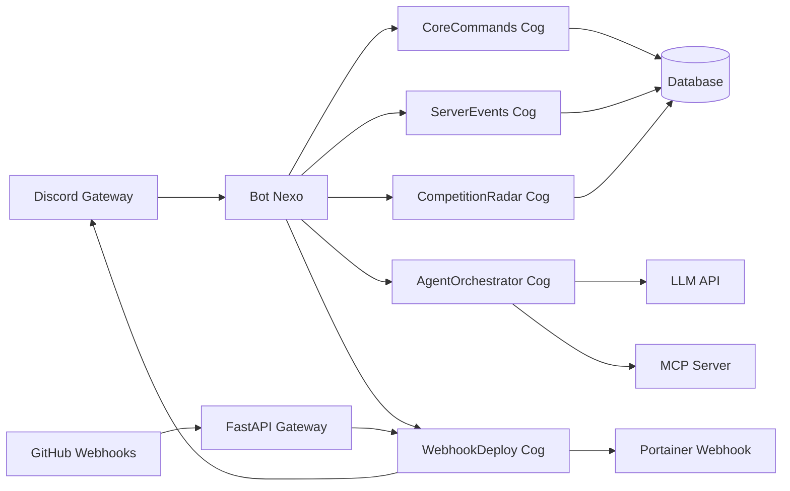

# Arsitektur umum

Saat proses dimulai, `main.py` membuat Discord bot dengan prefix `$`, mengaktifkan intent message content dan members, lalu memuat Cog utama. Aplikasi juga memulai FastAPI webhook gateway secara asynchronous.

Local tools didaftarkan oleh Cog ke `bot.ai_tools` dan handler-nya ke `bot.local_tool_handlers`. Tools eksternal diambil dari MCP Server melalui SSE. Keduanya dikirim ke model dalam format function calling yang kompatibel dengan OpenAI.

## Cog yang dimuat

- `CoreCommands`: command dasar, `$say`, antrean pengumuman, dan statistik layanan.
- `AgentOrchestrator`: antrean percakapan LLM, eksekusi tools, memory, dan statistik token.
- `ServerEvents`: pembuatan, pembaruan, penghapusan, dan sinkronisasi scheduled event.
- `WebhookDeploy`: notifikasi GitHub dan pemanggilan webhook Portainer.
- `CompetitionRadar`: data kompetisi dan reminder deadline.

Riwayat percakapan LLM disimpan per pengguna dan channel. ID baru untuk
conversation, pesan, dan pengumuman terjadwal dibuat sebagai UUIDv7. Waktu
`created_at` tetap menjadi acuan urutan pesan; UUIDv7 berurutan secara kasar
menurut waktu pembuatan, bukan pengganti timestamp atau jaminan urutan saat
beberapa proses menulis bersamaan.

Konfigurasi runtime berasal dari environment atau `.env`, termasuk token Discord, database, URL LLM, URL MCP, secret GitHub, channel tujuan, dan ID generator voice channel. Lihat [Konfigurasi dan deployment](configuration.md) untuk referensi lengkap.
