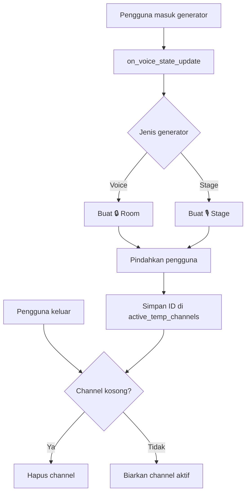

# Tools bawaan Discord

Tools lokal didaftarkan ke model sebagai function tools. Daftar yang ditampilkan oleh `$tools` dapat berubah ketika MCP Server menyediakan tools tambahan. Tools berikut adalah bawaan Nexo dari sisi Discord:

| Tool | Fungsi |
| --- | --- |
| `list_discord_events` | Menampilkan scheduled event dan event aktif di server. |
| `create_discord_event` | Membuat event atau meeting baru. |
| `end_discord_event` | Mengakhiri scheduled event. |
| `create_discord_thread` | Membuat thread pada channel saat ini. |
| `create_discord_poll` | Membuat native poll interaktif. |
| `end_discord_poll` | Menutup poll dan mengembalikan hasil suara. |
| `get_server_channels` | Mengambil daftar channel teks dan voice. |
| `get_server_roles` | Mengambil daftar role beserta ID. |
| `clear_messages` | Menghapus pesan secara massal. |
| `check_voice_channel` | Menampilkan anggota dalam voice channel. |

Nexo juga memiliki command langsung untuk sebagian fungsi tersebut, seperti `$clear`, `$voice`, `/voice`, dan `$tools`. Model menggunakan tool ketika permintaan ditulis dalam bahasa natural.

## Channel voice sementara

Nexo menyediakan dua generator yang dikonfigurasi melalui `GENERATOR_CHANNEL_ID` dan `GENERATOR_STAGE_ID`. Pengguna masuk ke salah satu generator, lalu listener `on_voice_state_update` membuat channel baru di category yang sama:

- voice biasa diberi nama `🔒 <nama pengguna>'s Room`;
- stage diberi nama `🎙 <nama pengguna>'s Stage`.

Nexo menyalin permission overwrite dari category dan memberikan pembuat channel izin mengelola channel, memindahkan anggota, dan mengatur permission. Pada stage, pembuat juga mendapat izin mute member. Setelah channel dibuat, pengguna langsung dipindahkan ke channel tersebut.

Ketika pengguna terakhir keluar dan channel menjadi kosong, Nexo menghapus channel dan mengeluarkan ID-nya dari daftar channel aktif. Saat bot menyala, Nexo memindai category yang dikonfigurasi: channel sementara yang kosong dibersihkan, sedangkan channel yang masih berisi anggota dimasukkan kembali ke cache. Karena itu channel sementara tetap dibersihkan setelah restart bot.

