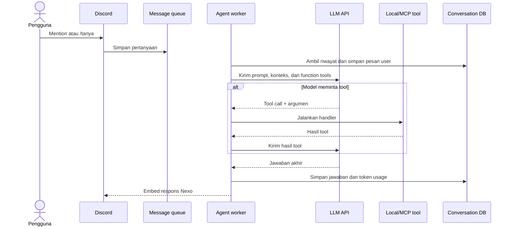

# Cara kerja chatbot LLM

Percakapan dapat dimulai dengan mention atau `/tanya`. Nexo memeriksa kesehatan provider LLM, menaruh pertanyaan ke `message_queue`, lalu memberi tahu posisi antrean jika ada permintaan lain. Satu worker mengambil item antrean dan memakai lock bot agar pemrosesan berjalan teratur.

Sebelum worker dipakai, Nexo memuat system prompt dari `prompts/system_prompt.md`, mengambil daftar tools MCP melalui SSE, menggabungkannya dengan local Discord tools, lalu membersihkan schema JSON agar ukuran konteks lebih kecil. Riwayat percakapan dibaca dari database dengan scope pasangan pengguna dan channel. Pesan dari channel atau pengguna lain tidak ikut menjadi konteks conversation tersebut.



Model memilih tool berdasarkan intent. Misalnya, pertanyaan tentang anggota voice channel dapat memanggil `check_voice_channel`, sedangkan permintaan membuat event dapat memanggil `create_discord_event`. Beberapa tool dalam satu putaran LLM dapat diminta sekaligus. Nexo mengeksekusi panggilan yang bersebelahan secara paralel hanya jika tool tersebut secara eksplisit ditandai read-only. Tool yang mengubah data dan tool MCP tanpa metadata read-only tetap dijalankan berurutan sesuai urutan panggilan model.

Jawaban ditampilkan sebagai embed Discord dengan durasi proses dan informasi token jika provider mengembalikannya. Jika LLM atau tool gagal, pengguna menerima pesan error dan kegagalan dicatat melalui logger.

## Provider LLM

`LLM_BASE_URL` harus menunjuk ke endpoint OpenAI-compatible provider, misalnya:

```env
# Azure OpenAI-compatible endpoint
LLM_BASE_URL=https://latihan-azure-1.services.ai.azure.com/openai/v1
LLM_API_KEY=your-api-key
LLM_MODEL_NAME=your-deployed-model
```

Untuk self-hosted LiteLLM gateway, `LLM_BASE_URL` dapat menunjuk ke route
gateway, misalnya `https://aiot.fik.upnvj.ac.id/gateway/v1`. Nexo mengambil
`tokenizer_with_hf_repo` dari `/gateway/v1/model/info?model=<LLM_MODEL_NAME>`
dan menghitung token dengan tokenizer Hugging Face tersebut. Azure tidak
menyediakan metadata tokenizer LiteLLM melalui route itu. Nexo mencoba memilih
tokenizer lokal dari nama model/deployment; deployment dengan nama khusus dapat
memakai fallback perkiraan.

Status provider memanggil endpoint `/models` melalui library `openai` /
`AsyncOpenAI`. Dengan begitu, pengecekan tidak perlu menghasilkan output model
dan tidak bergantung pada endpoint `/health` khusus llama.cpp.
