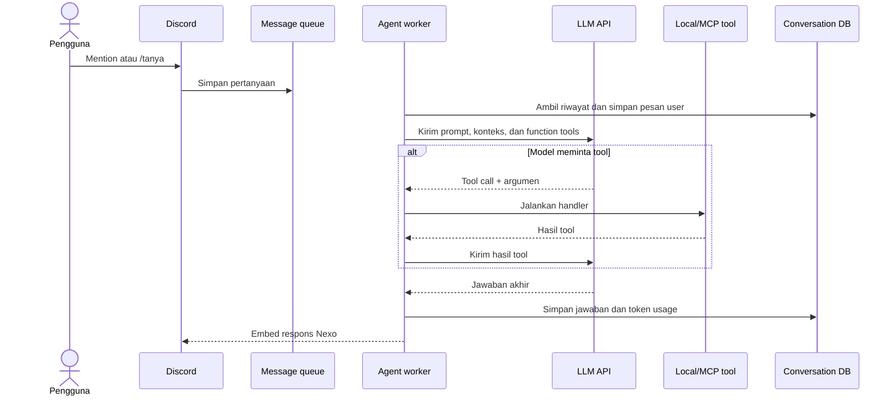

# Cara kerja chatbot LLM

Percakapan dapat dimulai dengan mention atau `/tanya`. Nexo memeriksa kesehatan provider LLM, menaruh pertanyaan ke `message_queue`, lalu memberi tahu posisi antrean jika ada permintaan lain. Satu worker mengambil item antrean dan memakai lock bot agar pemrosesan berjalan teratur.

Sebelum worker dipakai, Nexo memuat system prompt dari `prompts/system_prompt.md`, mengambil daftar tools MCP melalui SSE, menggabungkannya dengan local Discord tools, lalu membersihkan schema JSON agar ukuran konteks lebih kecil. Riwayat percakapan pengguna dibaca dari database dan dipakai sebagai konteks.

Model memilih tool berdasarkan intent. Misalnya, pertanyaan tentang anggota voice channel dapat memanggil `check_voice_channel`, sedangkan permintaan membuat event dapat memanggil `create_discord_event`. Untuk beberapa kebutuhan dalam satu pesan, system prompt meminta model memanggil tool yang relevan secara paralel.

Jawaban ditampilkan sebagai embed Discord dengan durasi proses dan informasi token jika provider mengembalikannya. Jika LLM atau tool gagal, pengguna menerima pesan error dan kegagalan dicatat melalui logger.
