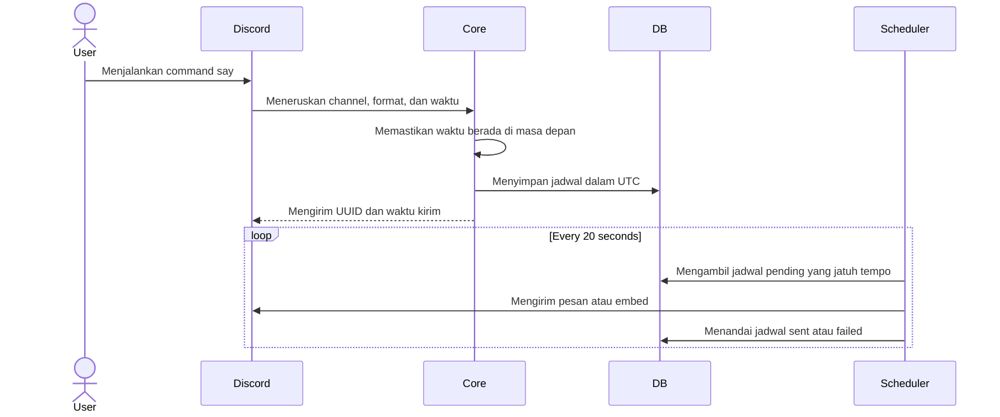

# Cara kerja auto scheduling

Nexo memiliki dua jenis penjadwalan. Pengumuman `$say` disimpan sebagai record database dan dikirim oleh loop `check_scheduled_announcements` setiap 20 detik. Scheduled Event Discord dan sinkronisasi Google Calendar ditangani oleh `ServerEvents`; pemeriksaan event yang perlu diproses berjalan pada interval 60 detik dan 15 menit sesuai jenis tugasnya.

Saat pengguna menjadwalkan pengumuman, Nexo memeriksa bahwa waktu berada di masa depan, menyimpan channel, pembuat, isi, format embed, judul, dan waktu UTC, lalu mengembalikan timestamp Discord serta UUID. Worker membaca record yang sudah jatuh tempo, mencari guild dan channel, menyelesaikan mention, mengirim pesan, dan mengubah status menjadi `sent`. Jika channel tidak ditemukan atau pengiriman gagal, status menjadi `failed`.

Untuk Discord Scheduled Event, pengguna dapat meminta Nexo melalui `/tanya`. Model akan meminta detail yang belum ada, seperti tanggal, jam, topik, dan lokasi. Setelah lengkap, tool lokal membuat event Discord dan dapat meneruskan data ke Google Calendar. Event yang berubah atau dihapus diproses oleh listener lifecycle.
